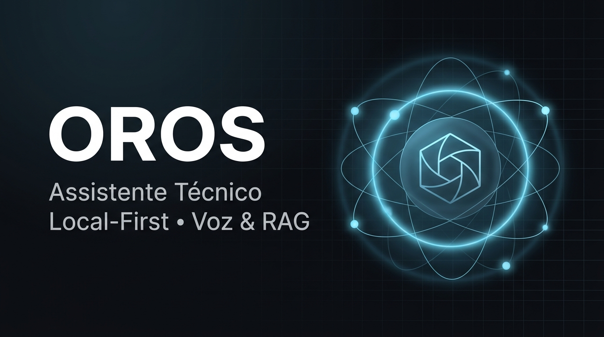
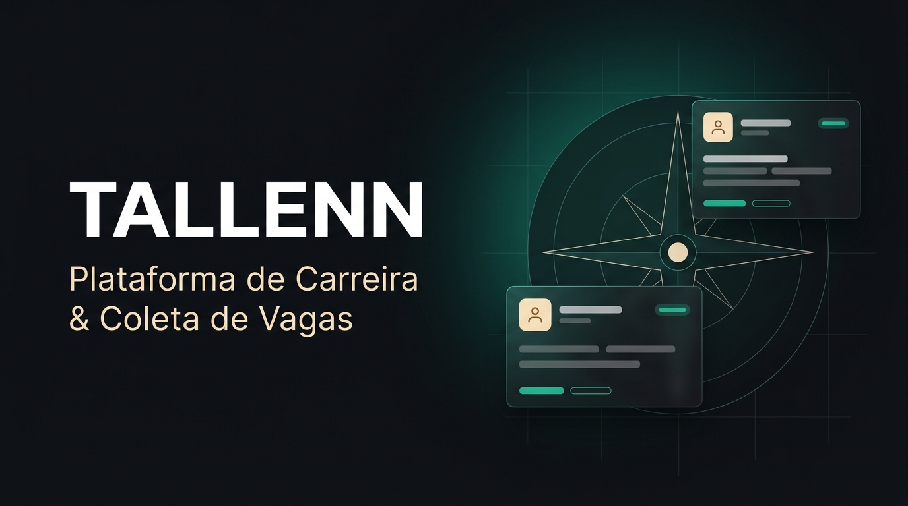
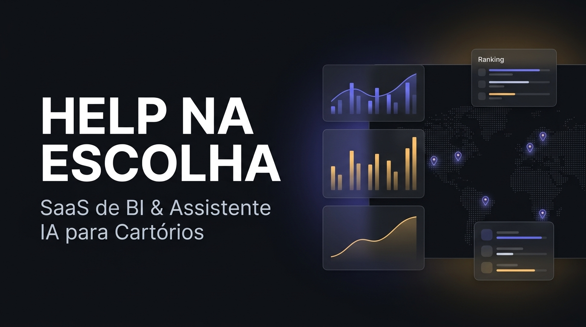
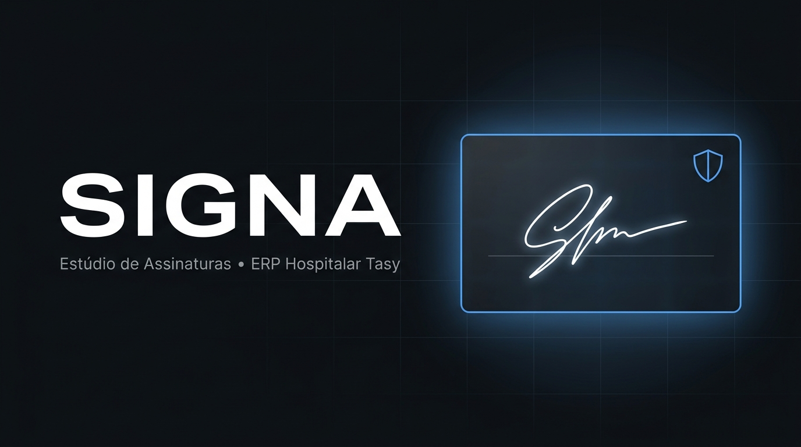

  <samp>
    <h1>
    <b>
      MARISSA BORGES
      </b>
    </h1>
  </samp>

  

  
  <samp>
    
Sou Marissa, estudante de Análise e Desenvolvimento de Sistemas, movida pela curiosidade de entender como as coisas funcionam e construir sistemas que resolvem problemas reais.

    
Atualmente, meu foco é o desenvolvimento full-stack e de aplicações com Inteligência Artificial em Python, utilizando Django, FastAPI, LangChain, RAG, agentes autônomos e automação web com Playwright. Estou em constante evolução buscando criar softwares cada vez mais sólidos, rápidos e bem projetados.
    

  </samp>
  

<!-- LinkedIn badge -->

<!-- E-mail badge -->

---

<!-- Profile Views -->

<!-- Total Stars with GitHub Logo -->

<!-- Followers with GitHub Logo -->

<h2>
<samp>
💻 Projetos em Destaque
</samp>
</h2>

<!-- INICIO DOS CARDS DE PROJETOS -->
<!-- 1929x1080 px-->
<table>
  <tr>
    <td>
      

        
        <samp>
<b>OROS</b>
</samp>
        <samp>
Assistente técnico local-first com interface orbital, voz cross-browser, RAG e orquestração de agentes.
</samp>
        

          
          
          
          
          
          
        

        

          
<samp>Última atualização: </samp>

          
<a href="https://github.com/MarissaBorges/oros"><samp>Saiba mais →</samp></a>

        

      

    </td>
    <td>
      

        
        
<samp><b>Tallenn</b></samp>

        
<samp>Plataforma de carreira e coleta automática de vagas com fila assíncrona, automação web e interface animada.</samp>

        

          
          
          
          
          
          
        

        

          
<samp>Última atualização: </samp>

          
<a href="https://github.com/MarissaBorges/tallenn"><samp>Saiba mais →</samp></a>

        

      

    </td>
  </tr>
  <tr>
    <td>
      

        
        
<b><samp>Help na Escolha</samp></b>

        
<samp>Plataforma SaaS de Business Intelligence e assistente IA (Tool-Calling + RAG) para análise de serventias extrajudiciais.</samp>

        

          
          
          
          
          
          
        

        
<samp>Última atualização: </samp>

        
<a href="https://github.com/MarissaBorges/Help-na-Escolha"><samp>Saiba mais →</samp></a>

      

    </td>
    <td>
      

        
        
<b><samp>Signa</samp></b>

        
<samp>Estúdio de assinaturas com evidências auditáveis, criptografia libsodium e integração ao ERP Hospitalar Tasy.</samp>

        

          
          
          
          
          
        

        
<samp>Última atualização: </samp>

        
<a href="https://github.com/MarissaBorges/signa"><samp>Saiba mais →</samp></a>

      

    </td>
  </tr>
</table>
<!-- FIM DOS CARDS DE PROJETOS -->

---

<h2>
<samp>
📊 Estatísticas
</samp>
</h2>

 

  
  
   
   
  
   
   
  
  

